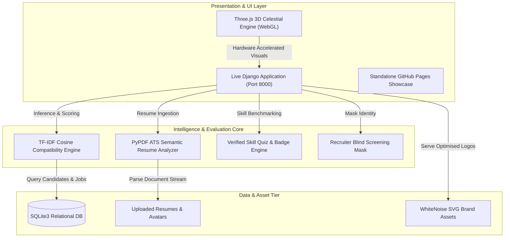

<div align="center">

# 🌐 HireSphere // Intelligent Career Console
### Autonomous Career Orchestration & Bias-Free Talent Matching Platform


<p align="center">
  <strong>A modern, full-stack recruitment ecosystem featuring mathematical TF-IDF skill matching, real-time ATS resume scoring, verified competency benchmarking, and recruiter blind screening.</strong>
</p>

[Quickstart](#-quick-start) • [Repository Structure](#-repository-structure) • [System Architecture](#-system-architecture) • [Matching Engine Specs](#-matching-engine--ats-specifications) • [Demo Credentials](#-pre-configured-demo-credentials) • [Academic Team](#-academic-project-team)

---
</div>

## 📌 Project Overview

**HireSphere** is an intelligent career orchestration and talent matchmaking platform engineered to eliminate keyword stuffing, resume exaggeration, and unconscious recruiter bias from hiring pipelines.

The system features a **dual-tier implementation**:
1. **Production Django Full-Stack Core (`django_backend/`)**: Powered by Python 3.14 & Django 5.1, featuring relational SQLite data models, cryptographic user auth, mathematical TF-IDF candidate-job ranking, PyPDF resume analysis, interactive skill quizzes, and recruiter anonymous masking.
2. **Standalone Web Client (`index.html` / `frontend/`)**: A zero-dependency interactive client with an integrated Three.js WebGL 3D celestial sphere, persistent dark/light mode, and dynamic career motivation quote rotators deployed live on GitHub Pages.

---

## 📂 Repository Structure

The project follows standard open-source and enterprise full-stack web application conventions:

```text
├── .vscode/                       # Visual Studio Code workspace configurations
│   ├── launch.json                # F5 debug profiles (Django Server, KTU Test Suite)
│   ├── settings.json              # Python path, Pylance extra paths, and Django template bindings
│   ├── tasks.json                 # Pre-configured build tasks (Start Server, Run Tests, Migrate)
│   └── extensions.json            # Recommended workspace development extensions
│
├── django_backend/                # Full-Stack Django 5.1 Core Application
│   ├── apps/                      # Modular application domain architecture
│   │   ├── users/                 # Custom user model, ATS analyzer, profiles, and quizzes
│   │   ├── jobs/                  # Vacancies, TF-IDF matching engine, application workflow
│   │   ├── companies/             # Partner employer directory, recruiter portal, blind review
│   │   └── admin_panel/           # Platform metrics aggregation and administrative oversight
│   ├── sk_platform/               # Project configuration (settings, urls, wsgi, asgi)
│   ├── static/                    # Production static assets (CSS, JS, SVG brand logos)
│   ├── templates/                 # Base layout templates with 3D canvas and dynamic dark theme
│   ├── media/                     # Uploaded applicant PDF resumes and candidate avatars
│   ├── db.sqlite3                 # Seeded SQLite relational database with demo data
│   ├── manage.py                  # Django CLI management executable
│   └── test_all_features.py       # 6-Suite automated verification test runner
│
├── frontend/                      # Standalone presentation showcase screens
│   ├── index.html                 # Main showcase entry point
│   ├── companies.html             # Partner employer directory (Fig 4.6)
│   ├── profile.html               # Candidate profile and ATS score gauge (Fig 4.4 & 4.5)
│   ├── quiz.html                  # Competency assessment UI
│   ├── quiz_result.html           # Skill validation and badge award UI
│   ├── register.html              # Candidate registration and login portal (Fig 4.3)
│   └── img/                       # High-resolution UI assets and SVG company marks
│
├── docs/                          # Academic documentation and assets
│   ├── report 4.pdf               # Official KTU B.Tech Mini Project Report
│   └── extract_report_assets.py   # PDF asset extractor utility
│
├── archives/                      # Legacy prototypes and historical project backups
│   └── legacy_prototype/          # Initial single-file models/views (Oct 2026)
│
├── build.sh                       # Automated Linux cloud build script
├── Procfile                       # Container process definition for cloud hosting
├── render.yaml                    # Render cloud deployment blueprint
├── requirements.txt               # Pinned Python dependencies
├── RUN_PROJECT.bat                # 1-Click Windows execution script
├── .gitignore                     # Git ignore rules for Python, Django, and archives
└── README.md                      # Project documentation
```

---

## 🚀 Quick Start

### 1. Clone & Set Up Environment
```bash
git clone https://github.com/ebiin-0/HireSphere.git
cd HireSphere

# Create virtual environment
python -m venv venv
# On Windows:
venv\Scripts\activate
# On macOS / Linux:
source venv/bin/activate

# Install dependencies
pip install -r django_backend/requirements.txt
```

### 2. Launch the Application

#### Option A: 1-Click Desktop Launcher (Windows)
Simply double-click **`RUN_PROJECT.bat`** in the project directory. The launcher auto-detects Python, checks dependencies, boots the Django development server, and opens your browser to `http://127.0.0.1:8000/`.

#### Option B: Visual Studio Code (F5 Debugging)
1. Open this repository in VS Code:
   ```bash
   code .
   ```
2. Press **`F5`** (or select **Run & Debug** ➔ **Django: Run Server (Port 8000)**).
3. Access in browser at: `http://127.0.0.1:8000/`.

#### Option C: Manual CLI Command
```bash
cd django_backend
python manage.py runserver 127.0.0.1:8000
```

#### Option D: Standalone Browser Showcase (Zero Server Required)
Open **`https://ebiin-0.github.io/HireSphere/`** directly in any modern browser.

---

## 🏗️ System Architecture



---

## 🧠 Matching Engine & ATS Specifications

### 1. TF-IDF Skill Matching Engine
The system replaces arbitrary keyword lookups with a mathematical vectorization model that computes cosine similarity between applicant verified competencies and employer vacancy prerequisites:

$$\text{Similarity}(A, J) = \frac{\mathbf{v}_A \cdot \mathbf{v}_J}{\|\mathbf{v}_A\| \|\mathbf{v}_J\|}$$

* **Feature Vectorizer:** Weighted Term Frequency-Inverse Document Frequency (TF-IDF).
* **Skill Normalization:** Automatic canonical mapping across variant aliases (`Python 3` $\to$ `Python`, `ReactJS` $\to$ `React`, `Postgres` $\to$ `PostgreSQL`).
* **Missing Skill Diagnostics:** Automatically computes the set difference:
  $$\text{Skills}_{\text{missing}} = \text{Skills}_{\text{required}} \setminus \text{Skills}_{\text{matched}}$$

### 2. ATS Resume Scanner Architecture
* **Parser Engine:** `PyPDF` binary stream extractor with regex-based structural segmentation.
* **Evaluated Sections:** `Education`, `Experience`, `Projects`, `Technical Skills`, `Certifications`, `Contact Information`.
* **Format & Readability Score:** Computes structural density, section completeness, and industry keyword coverage on a 100-point scale.

---

## 🎯 4-Tier Candidate Compatibility Classification

| Tier Level | Match Score | Visual Indicator | Recommended System Action |
|---|---|---|---|
| 🟢 **STRONG FIT** | **85% – 100%** | Green `#00b848` | **Instant Shortlist** • Prioritize for Technical Interview |
| 🟡 **COMPETITIVE** | **65% – 84%** | Gold `#f59e0b` | **Fast-Track Review** • Flag for Recruiter Consideration |
| 🟠 **MODERATE** | **45% – 64%** | Orange `#f97316` | **Skill Upskilling** • Suggest Verification Quizzes |
| 🔴 **LOW** | **< 45%** | Rose `#ef4444` | **Prerequisites Missing** • Archive Application |

---

## 🔑 Pre-Configured Demo Credentials

Use these verified credentials during project demonstrations and viva evaluations:

| Role | Username | Password | Key Capabilities to Demonstrate |
| :--- | :--- | :--- | :--- |
| **Primary Job Seeker** | **`ebin`** | `ebin123` | **ATS Score (87%)**, 100% Python Badge, 1-Click Job Apply, Application Status Tracking |
| **Design Candidate** | **`alex_rivera`** | `alex123` | Product Designer candidate profile with UI/UX portfolio metrics |
| **Employer (TCS)** | **`tcs_demo`** | `demo123` | Recruiter Portal, Applicant Rankings, **Anonymous Blind Screening Toggle** |
| **Employer (Infosys)** | **`infosys_demo`** | `demo123` | Active corporate vacancy management and applicant reviews |
| **Employer (Intileo)** | **`intileo_demo`** | `demo123` | Software engineering job listings and candidate vetting |
| **System Administrator** | **`admin`** | `admin123` | Platform analytics dashboard at [`/admin-panel/`](http://127.0.0.1:8000/admin-panel/) |

---

## 🧪 Automated Testing & Verification

The repository includes a comprehensive 6-suite verification test suite:

```bash
cd django_backend
python test_all_features.py
```

```text
========================================
HIRESPHERE KTU MINI PROJECT TEST SUITE
========================================
[1] Testing Matching Engine: Compatibility Score = 100% [PASSED]
[2] Testing Resume Analyzer: ATS Quality Score = 87%   [PASSED]
[3] Testing Public Endpoints: All 6 HTTP routes return 200 OK [PASSED]
[4] Testing Job Seeker Flow: Profile, Quizzes, Badges   [PASSED]
[5] Testing Recruiter Flow: Blind Screening Mask Active [PASSED]
[6] Testing Admin Control: Metrics Aggregation Dashboard [PASSED]
========================================
ALL KTU MINI PROJECT TEST SUITES PASSED!
========================================
```

---

## 👥 Academic Project Team

**Institution:**  
**Mar Baselios Christian College of Engineering and Technology (MBCET)**, Peermade, Idukki, Kerala  
*Department of Computer Science & Engineering*  
*Affiliated with APJ Abdul Kalam Technological University (KTU)*

| Name | University Register No. | Contribution |
| :--- | :--- | :--- |
| **Ebin Abraham** | `MBC23CS049` | Project Lead & Full-Stack Systems Architecture |
| **Adishesh L** | `MBC23CS011` | Relational Database Models & Core Backend Logic |
| **Angel Mary Jose** | `MBC23CS026` | Frontend UI Design & Responsive Screen Layouts |
| **Ardhra Anna Mathews** | `MBC23CS029` | Quality Assurance, Testing Suites & Documentation |

**Faculty Project Guide:**  
**Prof. Nissu Simon**, Assistant Professor, Department of Computer Science & Engineering

---

## 📄 License & Attribution

This project is developed solely for educational and academic assessment purposes as part of the KTU B.Tech Computer Science and Engineering curriculum. Distributed under the **MIT License**.

<div align="center">
  <sub>© 2025 HireSphere. Academic capstone project developed at MBCET Peermade.</sub><br>
  <sub><i>"The future depends on what you do today." — Mahatma Gandhi</i></sub>
</div>
