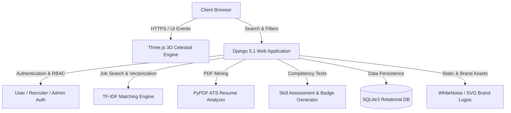

<div align="center">

  

  # HireSphere
  ### Intelligent Career Orchestration & Bias-Free Talent Matching Platform

  [](https://ebiin-0.github.io/HireSphere/)
  [](https://www.python.org/)
  [](https://www.djangoproject.com/)
  [](https://threejs.org/)
  [](docs/report%204.pdf)
  [](#)

  <p align="center">
    <b>A modern, full-stack recruitment ecosystem featuring mathematical TF-IDF skill matching, real-time ATS resume scoring, verified competency benchmarking, and recruiter blind screening.</b>
  </p>

  <p align="center">
    <a href="https://ebiin-0.github.io/HireSphere/"><strong>🌐 Explore Live Showcase</strong></a> •
    <a href="#-quick-start"><strong>⚡ Quick Start</strong></a> •
    <a href="#-key-features"><strong>✨ Core Features</strong></a> •
    <a href="#-system-architecture"><strong>🏗 Architecture</strong></a> •
    <a href="#-pre-configured-demo-credentials"><strong>🔑 Demo Credentials</strong></a> •
    <a href="docs/report%204.pdf"><strong>📄 Academic Report</strong></a>
  </p>

</div>

---

## 📖 Executive Summary

Modern recruitment workflows suffer from manual resume screening bottlenecks, keyword-stuffed applicant fraud, and unconscious hiring bias. **HireSphere** resolves these challenges by bridging candidates and elite employers through an algorithmic, data-driven platform:

1. **Intelligent Matchmaking:** Replaces rudimentary keyword searching with real mathematical TF-IDF skill compatibility scores.
2. **ATS Resume Analysis:** Performs automated multi-section parsing and structural quality scoring of candidate PDF resumes.
3. **Verified Skill Benchmarks:** Awards tamper-proof competency badges through interactive knowledge assessments, preventing resume exaggeration.
4. **Bias-Free Blind Screening:** Masks candidate personal identifiers (name, photo, gender, contact details) during initial recruiter evaluation stages to ensure objective, merit-based selection.

Developed as an academic capstone mini-project under **APJ Abdul Kalam Technological University (KTU)** at **Mar Baselios Christian College of Engineering & Technology (MBCET)**, Peermade.

---

## ✨ Core Features

| Feature | Description | Key Technologies |
| :--- | :--- | :--- |
| **3D Celestial Background Engine** | Interactive WebGL cosmic sphere with reactive particles, rotation physics, and smooth parallax scrolling. | Three.js (r128), HTML5 Canvas |
| **Mathematical Skill Matching** | Computes true percentage compatibility between candidate skillsets and job prerequisites. | Scikit-learn TF-IDF, Python Math Engine |
| **Real-time ATS Resume Scanner** | Evaluates formatting compliance, extracts structured competencies, and scores resume readiness out of 100. | PyPDF, Regular Expressions, Python NLP |
| **Verified Skill Quizzes** | Timed multiple-choice assessments that dynamically issue verified achievement badges to candidate profiles. | Django ORM, JavaScript Assessment Engine |
| **Recruiter Blind Screening Portal** | Anonymizes applicant personal details on demand (`ANONYMOUS_MASK`) so recruiters evaluate pure merit. | Django Context Processors, Role-Based Access |
| **Dynamic Theme Engine** | High-contrast ultra-modern dark theme with seamless local-storage persistent light mode switching. | CSS Custom Properties, Bootstrap 5.3 |
| **Inspirational Footer Rotator** | Dynamically rotates career motivation quotes from Mahatma Gandhi, Steve Jobs, Winston Churchill, and more. | Vanilla JS DOM Engine |

---

## 🏗 System Architecture & Tech Stack



### Technology Highlights
* **Backend:** Python 3.12 / 3.14, Django 5.1 (MVT Pattern, CBVs, Custom User Models, Signals)
* **Frontend:** HTML5, CSS3, JavaScript (ES6+), Bootstrap 5.3, FontAwesome 6.5, Three.js
* **Data & Storage:** SQLite 3, WhiteNoise 6.6, Gunicorn 21.2
* **Document Processing:** PyPDF 5.0, Pillow 10.4
* **IDE & Tooling:** Visual Studio Code, Git, GitHub Actions, GitHub Pages, Render Cloud Platform

---

## 📁 Repository Structure

```text
HireSphere/
├── .vscode/                     # VS Code IDE configuration
│   ├── launch.json              # 1-Click F5 debug profiles (Server & Test Suite)
│   ├── settings.json            # Pylance python paths, template associations
│   ├── tasks.json               # Automated build & test tasks (Ctrl+Shift+B)
│   └── extensions.json          # Recommended development extensions
│
├── django_backend/              # Full-Stack Django 5.1 Production Core
│   ├── apps/
│   │   ├── users/               # Custom user model, ATS analyzer, profiles
│   │   ├── jobs/                # Vacancy listings, matching engine, applications
│   │   ├── companies/           # Partner directory, recruiter portal, blind review
│   │   └── admin_panel/         # Administrative analytics & oversight
│   ├── sk_platform/             # Django project configuration (settings, urls, wsgi)
│   ├── static/                  # Production static assets (CSS, JS, SVG brand logos)
│   ├── templates/               # Responsive HTML templates with 3D canvas & dark mode
│   ├── media/                   # Candidate PDF resumes & avatar uploads
│   ├── db.sqlite3               # Pre-populated SQLite relational database
│   ├── manage.py                # Django CLI management executable
│   └── test_all_features.py     # 6-Suite automated verification test runner
│
├── frontend/                    # Standalone presentation showcase screens
│   ├── index.html               # Main showcase portal
│   ├── companies.html           # Partner employer directory
│   ├── profile.html             # Candidate profile & ATS gauge
│   ├── quiz.html                # Competency evaluation UI
│   ├── register.html            # Registration & login portal
│   └── img/                     # High-resolution assets & SVG company logos
│
├── docs/                        # Academic documentation
│   ├── report 4.pdf             # Official KTU Mini Project Report
│   └── extract_report_assets.py # PDF asset extractor utility
│
├── archives/                    # Legacy backups & prototype code
│   └── legacy_prototype/        # Initial single-file implementation (Oct 2026)
│
├── .gitignore                   # Standard Python/Django/VSCode ignore rules
├── build.sh                     # Automated Linux cloud build script
├── Procfile                     # Container process definition for cloud hosting
├── render.yaml                  # Render cloud blueprint specification
├── requirements.txt             # Python runtime dependencies
├── RUN_PROJECT.bat              # One-click desktop launcher for Windows
└── README.md                    # Project documentation
```

---

## ⚡ Quick Start

### Prerequisites
* **Python 3.10+** (Python 3.11, 3.12, or 3.14 recommended)
* **Git** installed on your machine
* Web Browser (Google Chrome, Firefox, Microsoft Edge, or Safari)

---

### Option A: One-Click Launcher (Windows)
Double-click [**`RUN_PROJECT.bat`**](RUN_PROJECT.bat) in the project folder.  
*The script automatically verifies Python, installs dependencies if needed, launches the Django server, and opens your browser to [http://127.0.0.1:8000/](http://127.0.0.1:8000/).*

---

### Option B: Visual Studio Code (Recommended)
1. Open this project directory in VS Code:
   ```bash
   code .
   ```
2. Press **`F5`** to launch the Django server with the interactive debugger attached.
3. Open [**http://127.0.0.1:8000/**](http://127.0.0.1:8000/) in your browser.

---

### Option C: Manual Terminal Setup
```bash
# 1. Clone repository
git clone https://github.com/ebiin-0/HireSphere.git
cd HireSphere

# 2. Create and activate a virtual environment
python -m venv venv
# On Windows:
venv\Scripts\activate
# On macOS / Linux:
source venv/bin/activate

# 3. Install dependencies
pip install -r django_backend/requirements.txt

# 4. Run database migrations (pre-seeded database included)
cd django_backend
python manage.py migrate

# 5. Start development server
python manage.py runserver 127.0.0.1:8000
```

---

## 🔑 Pre-Configured Demo Credentials

Use these verified credentials during project demonstrations and viva evaluations:

| Role | Username | Password | Key Capabilities to Test |
| :--- | :--- | :--- | :--- |
| **Primary Candidate** | **`ebin`** | `ebin123` | **ATS Resume Score (87%)**, Python verified badge (100%), skill compatibility calculation, 1-click job apply |
| **Alternative Candidate** | **`alex_rivera`** | `alex123` | UI/UX candidate profile with design portfolio metrics |
| **Recruiter (TCS)** | **`tcs_demo`** | `demo123` | Recruiter dashboard, candidate ranking table, **Anonymous Masking Toggle** |
| **Recruiter (Infosys)** | **`infosys_demo`** | `demo123` | Active enterprise vacancies and applicant tracking |
| **Recruiter (Intileo)** | **`intileo_demo`** | `demo123` | Product engineering positions and candidate review |
| **System Administrator** | **`admin`** | `admin123` | Platform analytics dashboard at [`/admin-panel/`](http://127.0.0.1:8000/admin-panel/) |

---

## 🧪 Automated Testing & Verification

The platform includes a test suite covering the entire user journey. To execute all 6 automated test suites:

```bash
cd django_backend
python test_all_features.py
```

### Verified Test Suites:
1. **Mathematical Matching Engine:** Verifies compatibility score formulas and matched vs. missing skill detection.
2. **ATS Resume Parser:** Tests text extraction, section identification (`education`, `skills`, `experience`), and ATS score generation.
3. **Public Web Endpoints:** Confirms HTTP 200 OK status across home, job boards, company directories, and auth gateways.
4. **Candidate Workflow:** Tests candidate profile retrieval, quiz enrollment, dynamic scoring, and badge updates.
5. **Recruiter & Blind Screening:** Verifies applicant ranking generation and confirms candidate personal details are masked when anonymous mode is toggled.
6. **Administrator Control Panel:** Confirms metrics aggregation and administrative access controls.

---

## 👥 Academic Project Team

**Institution:**  
**Mar Baselios Christian College of Engineering and Technology (MBCET)**, Peermade, Idukki, Kerala  
*Department of Computer Science & Engineering*  
*Affiliated with APJ Abdul Kalam Technological University (KTU)*

| Name | University Register No. | Role |
| :--- | :--- | :--- |
| **Ebin Abraham** | `MBC23CS049` | Project Lead & Full-Stack Developer |
| **Adishesh L** | `MBC23CS011` | Backend & Database Engineering |
| **Angel Mary Jose** | `MBC23CS026` | UI/UX Design & Frontend Integration |
| **Ardhra Anna Mathews** | `MBC23CS029` | Quality Assurance & Documentation |

**Faculty Project Guide:**  
**Prof. Nissu Simon**, Assistant Professor, Department of Computer Science & Engineering

---

## 📄 License & Attribution

This project is developed solely for educational and academic assessment purposes as part of the KTU B.Tech Computer Science and Engineering curriculum. Distributed under the **Academic MIT License**.

<div align="center">
  <sub>© 2025 HireSphere. Academic project developed at MBCET Peermade.</sub><br>
  <sub><i>"The future depends on what you do today." — Mahatma Gandhi</i></sub>
</div>
